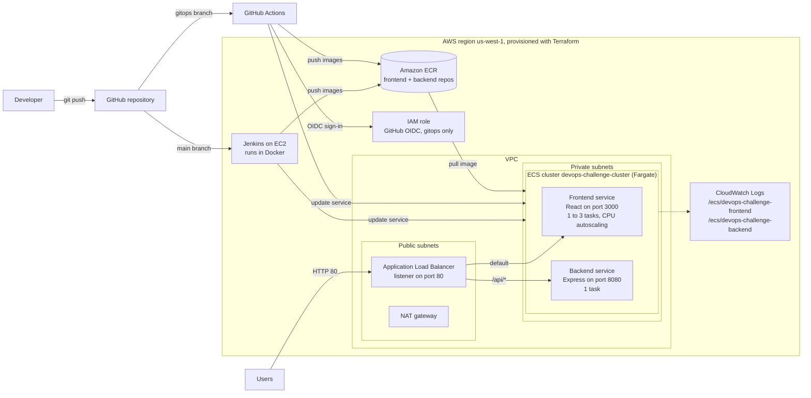

# React and Express on AWS ECS: Terraform, Jenkins and GitHub Actions

A React frontend and an Express backend, deployed publicly on AWS. Terraform builds the infrastructure, Docker packages both apps, and both run as Fargate services on Amazon ECS behind an Application Load Balancer. Two pipelines deploy updates: **Jenkins** (`main` branch) and **GitHub Actions** (`gitops` branch).

## Architecture

<p align="center">
  
</p>

<details>
<summary>View the text-based diagram (Mermaid)</summary>



</details>

## At a glance

| | |
| --- | --- |
| Frontend URL | http://devops-challenge-alb-139201318.us-west-1.elb.amazonaws.com |
| Backend API | http://devops-challenge-alb-139201318.us-west-1.elb.amazonaws.com/api/ |
| Region | `us-west-1` |
| ECS cluster | `devops-challenge-cluster` |
| ECR repositories | `devops-challenge-frontend`, `devops-challenge-backend` |
| Ports | Frontend `3000`, backend `8080`, ALB listener `80` |
| Scaling | Frontend 1 to 3 tasks (CPU target tracking), backend 1 task |

The ALB address changes if the infrastructure is destroyed and rebuilt. Update the URLs above and in the config files when that happens.

## How it works

| Component | Role |
| --- | --- |
| Terraform | Creates the VPC (2 public and 2 private subnets, NAT gateway), ALB, ECR, ECS on Fargate, IAM roles, CloudWatch log groups, autoscaling and the Jenkins EC2 instance |
| ALB | Sends `/api/*` to the backend target group and everything else to the frontend target group |
| ECS Fargate | Runs the frontend (port 3000) and backend (port 8080) containers in private subnets |
| Jenkins (`main`) | Builds both images, pushes to ECR, forces new ECS deployments |
| GitHub Actions (`gitops`) | Signs in to AWS with OIDC, builds and pushes both images, updates the ECS services |

## Prerequisites

- AWS account with CLI credentials configured (`aws configure`, region `us-west-1`)
- Git, Node.js and npm, Docker, Terraform
- Replace the account ID (`060255765406`) and ALB address with your own where they appear.

## Repository structure

| Path | Contents |
| --- | --- |
| `backend/` | Express API, `config.js` (CORS origin), `Dockerfile` |
| `frontend/` | React app, `src/config.js` (backend URL), `Dockerfile` |
| `*.tf` | Terraform: VPC, ECR, ECS and Fargate, load balancer, IAM, Jenkins server, variables, outputs |
| `Jenkinsfile` | Jenkins pipeline (`main`) |
| `.github/workflows/deploy.yml` | GitHub Actions workflow (`gitops`) |
| `images/` | Architecture diagram |

## Deployment

### 1. Run locally

Start the backend first, then the frontend in a second terminal:

```bash
cd backend
npm ci
npm start
```

```bash
cd frontend
npm ci
npm start
```

Open http://localhost:3000. The page shows **SUCCESS** followed by a GUID when the frontend reaches the backend at http://localhost:8080.

### 2. Provision the infrastructure

From the folder containing the `.tf` files:

```bash
aws sts get-caller-identity
terraform init
terraform fmt
terraform validate
terraform plan
terraform apply
```

Review the plan, then enter `yes`. Terraform creates the networking, ALB, target groups, listener rules, ECR repositories, ECS cluster and services, task roles, log groups and autoscaling. Keep `terraform.tfstate` out of Git.

### 3. Point the apps at the load balancer

Get the ALB address from the Terraform output or the EC2 console, then set:

- `frontend/src/config.js`: `backendUrl: "http://YOUR_ALB_DNS/api/"`
- `backend/config.js`: `CORS_ORIGIN: "http://YOUR_ALB_DNS"` (no `/api/`)

### 4. Build and push the images

Do this once so the ECS services have images to start. Later, the pipelines do it for you.

```bash
aws ecr get-login-password --region us-west-1 | docker login --username AWS --password-stdin 060255765406.dkr.ecr.us-west-1.amazonaws.com

docker build -t devops-challenge-frontend ./frontend
docker tag devops-challenge-frontend:latest 060255765406.dkr.ecr.us-west-1.amazonaws.com/devops-challenge-frontend:latest
docker push 060255765406.dkr.ecr.us-west-1.amazonaws.com/devops-challenge-frontend:latest

docker build -t devops-challenge-backend ./backend
docker tag devops-challenge-backend:latest 060255765406.dkr.ecr.us-west-1.amazonaws.com/devops-challenge-backend:latest
docker push 060255765406.dkr.ecr.us-west-1.amazonaws.com/devops-challenge-backend:latest
```

Then force a new deployment of each service:

```bash
aws ecs update-service --cluster devops-challenge-cluster --service devops-challenge-frontend-service --force-new-deployment --region us-west-1
aws ecs update-service --cluster devops-challenge-cluster --service devops-challenge-backend-service --force-new-deployment --region us-west-1
```

### 5. Verify

In the ECS console, each service should show 1 running task and a healthy target. Then:

```bash
curl -i http://YOUR_ALB_DNS/api/
```

The API should return a successful status and JSON like `{"message":"SUCCESS ..."}`. Open `http://YOUR_ALB_DNS` in a browser to see **SUCCESS** and a GUID on the frontend.

## CI/CD

### Jenkins (`main`)

1. Run Jenkins in Docker on the Terraform-provisioned EC2 instance (install Docker first and start the service).
2. Restrict port 8080 and SSH (port 22) on the Jenkins security group to your own IP.
3. Complete the Jenkins setup, install the Pipeline, Git, Docker Pipeline, AWS Credentials and Workspace Cleanup plugins.
4. Add AWS credentials in Jenkins and put their ID in the `Jenkinsfile`.
5. Create a Pipeline job from SCM: this repository, branch `*/main`, script path `Jenkinsfile`.
6. Push to `main`. The pipeline checks out the code, builds both images, signs in to ECR, pushes both images, forces new ECS deployments and cleans the workspace.

Open Jenkins at `http://YOUR_JENKINS_IP:8080`. Use the current EC2 IP after any rebuild.

### GitHub Actions (`gitops`)

1. In AWS IAM, add the OIDC provider `token.actions.githubusercontent.com`.
2. Create the role `GitHubActions-ECS-Deploy-Role` with the AmazonEC2ContainerRegistryPowerUser and AmazonECS_FullAccess policies. Restrict its trust policy to this repository's `gitops` branch.
3. Add `.github/workflows/deploy.yml` (workflow **Deploy to ECS**) to sign in through OIDC, build and push both images, and update the ECS services.
4. Push to `gitops` and confirm the **build-and-deploy** job succeeds.

## Load testing and autoscaling

Siege was not available in the Amazon Linux repositories, so it runs from a temporary Docker container on an EC2 instance:

```bash
sudo docker run --rm yokogawa/siege -c 250 -t 2M http://YOUR_ALB_DNS
```

Recorded result: 250 concurrent users for 2 minutes, 55,317 successful transactions, 100% availability and 0 failures. The frontend autoscaling policy raised the desired task count to 3.

## Troubleshooting

| Problem | Fix |
| --- | --- |
| ALB returns 503, no healthy targets | The tasks stopped because the log group was missing. Create `/ecs/devops-challenge-frontend` and `/ecs/devops-challenge-backend` in `us-west-1`, set `awslogs-region` to `us-west-1` in both task definitions, then force new deployments |
| `/api/` returns HTML | The listener rule for `/api/*` needs a higher priority than the default rule and must forward to the backend target group |
| Frontend shows a network or CORS error | `frontend/src/config.js` must use the ALB URL plus `/api/`, and `backend/config.js` must use the ALB URL without `/api/`. Check the backend task is healthy |
| `git push` rejected, fetch first | Run `git pull --rebase origin main`, then push again |
| Docker build fails with "no space left on device" | Free disk space with `docker system prune`, or increase the EC2 volume size |

## Cost and cleanup

AWS Free Tier credits do not cover everything. The ALB, NAT gateway, Fargate tasks, public IPv4 addresses and CloudWatch can all incur charges. Set an AWS Budget. To pause, set the ECS desired counts to 0 and stop the Jenkins instance (the ALB and NAT gateway still bill). To remove everything:

```bash
terraform destroy
```

Review the destroy plan before entering `yes`.

## Submission checklist

- [ ] Repository is private and shared with the reviewer
- [ ] Terraform, Dockerfiles, `Jenkinsfile` and the workflow are committed, with no state files, keys or secrets
- [ ] Frontend and backend config files use the ALB URL
- [ ] Jenkins pipeline finishes with SUCCESS
- [ ] Both ECS services are running and healthy
- [ ] The frontend URL shows **SUCCESS** and a GUID
- [ ] `images/architecture.png` is uploaded next to this README
- [ ] Jenkins server URL and reviewer credentials entered in the private submission field
